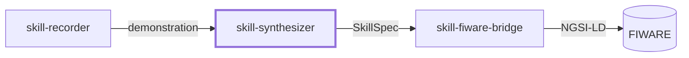
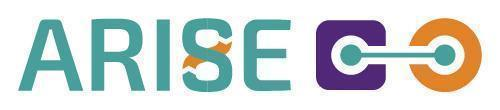

# Skill Synthesizer

A ROS 2 module that turns a recorded demonstration into a skill specification (SkillSpec): a structured, machine-readable description of the steps of the demonstrated task.

> **Status:** this repository is being prepared. The first public release, with source code, installation guide and a runnable example, is planned for **June 2027**.

## Related modules

`skill-synthesizer` is designed to be used on its own or together with two companion modules:

*skill-fiware-bridge can also publish task-step and component events from your own robot application.*

- [skill-recorder](https://github.com/eurodao/skill-recorder)
- [skill-fiware-bridge](https://github.com/eurodao/skill-fiware-bridge)

## Features

*To be completed with the first release.*

## Requirements

*To be completed with the first release* (ROS 2 Jazzy on eProsima Vulcanexus; Ubuntu 24.04).

## Installation

*To be completed with the first release.*

## Usage

*To be completed with the first release* — including a minimal "hello world" example and a basic demo.

## Known limitations

*To be completed with the first release.*

## Third-party notices

*To be completed with the first release.*

## Contributing

Issues and suggestions are welcome. Code contributions will be accepted after the first release. Contributors will be asked to sign a Contributor License Agreement that gives euroDAO SAS the right to relicense the contribution under GPL-3.0-only or under a later, more permissive licence.

## License

Copyright © 2026 euroDAO SAS.

Code: [GNU General Public License v3.0 only](LICENSE) (`SPDX-License-Identifier: GPL-3.0-only`).

## Maintainer

**euroDAO SAS**, Montpellier, France · [eurodao.com](https://eurodao.com) · info@eurodao.com

## Acknowledgements

Developed by euroDAO SAS within the MENTOR experiment of the ARISE project, for the ARISE Catalog.

&nbsp;&nbsp;

Funded by the European Union. Views and opinions expressed are however those of the author(s) only and do not necessarily reflect those of the European Union or European Commission. Neither the European Union nor the granting authority can be held responsible for them. Co-funded under Horizon Europe Programme of the European Union under Grant Agreement no. 101135784.
